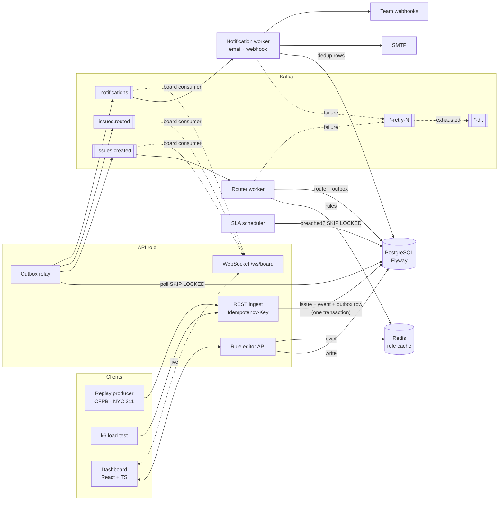

# RouteIQ

Event-driven issue routing and SLA platform. Issues come in over a REST API, a rules engine assigns each one to a
team, workers notify the team by email and webhook, and a scheduler escalates anything that misses its SLA. A React
dashboard shows the board live over WebSocket and lets you edit routing rules.

Two tenants are fed from real public data: the **CFPB Consumer Complaint Database** and **NYC 311 Service
Requests** (Socrata). A replay producer streams historical records into the API at 1×, 10×, 100× (or any) real time.

## Architecture



**Flow of one issue**

1. `POST /api/tenants/{tenant}/issues` with an `Idempotency-Key` header. In one transaction the API stores the key
   with a SHA-256 of the canonical request body, inserts the issue (`NEW`), appends a `CREATED` audit event and writes
   an outbox row. A repeat of the same key and body returns the original issue (`200`, `Idempotent-Replayed: true`);
   the same key with a different body is rejected with `422`.
2. The outbox relay publishes unpublished rows to Kafka and marks them published only after the broker acknowledges.
   Rows are claimed with `FOR UPDATE SKIP LOCKED`, so several relays can run at once.
3. The router consumes `issues.created`, locks the issue row, evaluates the tenant's rules (from Redis, falling back
   to Postgres if Redis is down) and marks it `ROUTED` with a team and an SLA deadline. The `issues.routed` and
   `notifications` messages go through the outbox in the same transaction. A redelivered message finds the issue
   already routed and does nothing.
4. The notifier sends the notification over every channel the team has. Each `(dedupKey, channel)` pair is a row in
   `notifications`, so a retry only re-sends the channels that have not succeeded yet.
5. The SLA scheduler finds routed issues past their deadline, marks them breached, appends `SLA_BREACHED` and queues an
   `ESCALATION` notification. Acknowledging an issue stops the SLA clock.
6. Failures go to retry topics with exponential backoff (`issues.created-retry-*`, `notifications-retry-*`) and then
   to a dead-letter topic (`*-dlt`). Malformed payloads and unknown issues skip straight to the DLT. A dead-lettered
   notification is marked `FAILED` and recorded as a `NOTIFICATION_FAILED` event.

Delivery is at-least-once end to end; every consumer is idempotent, which is what makes that safe.

### Design choices

| Choice | Why |
|---|---|
| One service image, roles switched by env vars | API, router, notifier and SLA scheduler scale independently (separate Deployments in Helm, separate containers in compose) without four codebases. |
| Transactional outbox instead of publishing from the request | Publishing after commit can lose events on a crash; publishing before commit can emit events for rolled-back rows. |
| Row locks + status checks for idempotent consumers | Kafka can redeliver after a rebalance; the database is the source of truth for "already done". |
| `issue_events` protected by a trigger | The audit log rejects `UPDATE` and `DELETE` at the database level, not just by convention. |
| Rules cached per tenant in Redis, evicted on write | The router reads rules on every issue; edits must take effect on the next issue. |
| Spring JDBC (`JdbcClient`) rather than JPA | The hot paths are a handful of explicit SQL statements (`ON CONFLICT`, `SKIP LOCKED`, `jsonb`). |

### Data model

`tenants`, `teams`, `routing_rules`, `issues`, `issue_events` (append-only audit log), `notifications`,
`idempotency_keys`, plus `outbox`. See [`V1__schema.sql`](service/src/main/resources/db/migration/V1__schema.sql).
Seed data ([`V2__seed_tenants.sql`](service/src/main/resources/db/migration/V2__seed_tenants.sql)) creates both tenants,
their teams and starter rules.

Rules match one field (`category`, `title`, `description`, `externalId` or `attr.<name>`) with `EQUALS`, `CONTAINS`,
`PREFIX`, `IN` or `REGEX`, case-insensitively. They run in ascending priority; the first match wins, and unmatched
issues go to the tenant's default team with the tenant's default SLA.

## Running it

Requirements: Docker. For development: JDK 21, Node 22, Python 3.11+.

```bash
docker compose up -d --build
```

| URL | What |
|---|---|
| http://localhost:3000 | Dashboard (live board, rule editor) |
| http://localhost:8080/api/tenants | REST API |
| http://localhost:8025 | Mailpit (email notifications) |
| `docker compose logs -f webhook-sink` | Webhook notifications |

Feed it real data:

```bash
cd replay
python3 replay.py fetch  --source nyc311 --limit 5000
python3 replay.py fetch  --source cfpb   --limit 2000
python3 replay.py replay --source nyc311 --speed 100
python3 replay.py replay --source cfpb   --speed 1000 --max-gap 0.5
```

The idempotency key is derived from the source record id, so replaying the same file again creates no duplicates.

Observability (Prometheus, Grafana with a provisioned dashboard, Jaeger for OpenTelemetry traces):

```bash
TRACING_EXPORT_ENABLED=true docker compose --profile observability up -d
```

Prometheus on :9090, Grafana on :3001 (dashboard "RouteIQ pipeline"), Jaeger on :16686.

### API

| Method | Path | |
|---|---|---|
| `POST` | `/api/tenants/{t}/issues` | Create (requires `Idempotency-Key`) |
| `GET` | `/api/tenants/{t}/issues?status=&breached=&limit=` | List |
| `GET` | `/api/tenants/{t}/issues/{id}` | Issue with audit events and notifications |
| `POST` | `/api/tenants/{t}/issues/{id}/acknowledge` | Stop the SLA clock |
| `POST` | `/api/tenants/{t}/issues/{id}/resolve` | Resolve |
| `GET` | `/api/tenants/{t}/issues/stats` | Counts by status |
| `GET/POST` | `/api/tenants/{t}/rules` | List / create rules |
| `PUT/DELETE` | `/api/tenants/{t}/rules/{id}` | Update / delete a rule |
| `POST` | `/api/tenants/{t}/rules/dry-run` | Which rule and team would this issue get? |
| `WS` | `/ws/board?tenant={t}` | Live board events |

## Tests

```bash
cd service && ./mvnw verify          # unit + Testcontainers (Postgres, Kafka, Redis); needs Docker
cd dashboard && npm ci && npm test
cd replay && python3 -m unittest -v test_replay
```

The integration suite runs the whole pipeline against real containers and checks:

- ingest → route → webhook delivered → notification marked `SENT`, with the audit trail `CREATED, ROUTED`
- same key and body returns the original issue; same key with a different body returns `422`
- 16 concurrent requests with one key create exactly one issue
- a rule created through the API routes the very next issue; deleting it falls back to the default team
- an SLA breach escalates exactly once across repeated scans; acknowledged issues are not escalated
- a webhook that keeps failing is tried 3 times (main topic + 2 retry topics), then dead-lettered and marked `FAILED`
- `UPDATE`/`DELETE` on `issue_events` is rejected
- a WebSocket client receives `CREATED` and `ROUTED` for a new issue

CI (GitHub Actions) runs all three suites, lints and renders the Helm chart, validates the compose file and builds
both images.

## Benchmarks

BENCHMARKS_PLACEHOLDER

## Deployment

- `docker-compose.yml`: the full stack on one machine, one container per role.
- `deploy/helm/routeiq`: one Deployment per role, a Service for the API, optional Ingress and PodMonitor. Postgres,
  Kafka and Redis are expected to be provided separately. The chart is linted and rendered in CI; it has not been
  deployed to a real cluster yet.

## Roadmap

- Multi-level escalation (escalate again, to a different team, after a second deadline).
- Per-tenant API authentication and rate limiting.
- Business-hours SLA calendars.
- Rules with several conditions (AND/OR) instead of one field per rule.
- Publish images to GHCR from CI and run the Helm chart against kind in CI.
- A sustained-load benchmark on dedicated hardware rather than a laptop.

## Data sources

- [CFPB Consumer Complaint Database](https://www.consumerfinance.gov/data-research/consumer-complaints/) (public domain, CC0)
- [NYC 311 Service Requests](https://data.cityofnewyork.us/Social-Services/311-Service-Requests-from-2010-to-Present/erm2-nwe9) (NYC Open Data)
